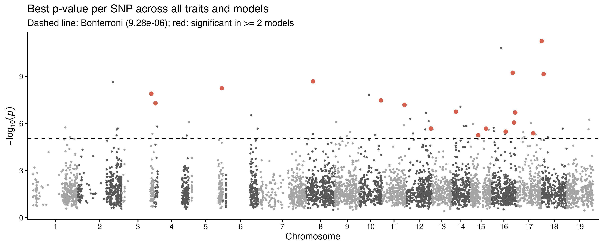

# Miscanthus GWAS: FarmCPU, BLINK and MLM consensus with candidate genes

Genome-wide association study of 26 growth, phenology and biomass traits
measured in 2015 and 2016 on 953 *Miscanthus* genotypes from the ABR33 trial.
Each trait is analysed with three GAPIT models: FarmCPU, BLINK and MLM. A marker
is kept as a **consensus** association when it passes the Bonferroni threshold
in at least two of the three models. Genes within ±10 kb of each consensus
marker are then annotated using the *Miscanthus sinensis* v7.1 genome.

## Key results

- **5,387 SNPs** were tested; the Bonferroni threshold is 0.05 / 5,387 = **9.28 × 10⁻⁶**.
- Bonferroni-significant marker–trait hits: BLINK 62, FarmCPU 52, MLM 17.
- **30 consensus associations at 17 unique SNPs** gave **21 candidate genes**.
- Genomic inflation λ: median 0.96 (range 0.78–1.43).

| SNP | Traits | Models | Best p | Nearest gene | Location | Putative function |
|---|---|---|---|---|---|---|
| Chr03_100116033 | AUC_15, dry_matter_plant_15, fresh_weight_plant_15 | all 3 | 1.3e-08 | Misin03G313000 | 1.5 kb downstream | 5-formyltetrahydrofolate cyclo-ligase |
| Chr04_4349989 | moisture_content_16 | BLINK+FarmCPU | 5.2e-08 | Misin04G022700 | 1.6 kb upstream | OS07G0121000 protein |
| Chr05_110903979 | DayAt15cm_2016, DayAt25cm_2016, DegDays25cm_2016 | all 3 | 5.7e-09 | Misin05G390700 | 6.8 kb downstream | ARM repeat superfamily protein |
| Chr08_23376001 | fresh_weight_plant_16 | BLINK+FarmCPU | 2.1e-09 | – | no gene within 10 kb | – |
| Chr10_71969965 | Start_Exp_G_16 | BLINK+FarmCPU | 3.4e-08 | Misin10G192600 | within gene | Expressed protein |
| Chr11_76542011 | AUC_15, MaxGR_16 | BLINK+FarmCPU | 6.5e-08 | Misin11G240900 | within gene | Prenyltransferase (dimethylallyltranstransferase) |
| Chr12_82415987 | moisture_content_16 | BLINK+FarmCPU | 2.1e-06 | Misin12G262200 | 8.0 kb downstream | Uncharacterised |
| Chr14_13354094 | Duration_16 | BLINK+FarmCPU | 1.8e-07 | – | no gene within 10 kb | – |
| Chr15_27510009 | DegDays15cm_2016 | FarmCPU+MLM | 5.6e-06 | Misin15G095400 | 1.3 kb downstream | Suppressor of gene silencing 3 (SGS3) |
| Chr15_54083961 | MaxGR_16 | BLINK+FarmCPU | 2.1e-06 | Misin15G138000 | within gene | Predicted membrane protein |
| Chr16_46686006 | DegDays15cm_2016 | BLINK+FarmCPU | 3.3e-06 | – | no gene within 10 kb | – |
| Chr16_70319981 | DayAt15/25cm and DegDays15/25cm (2015 and 2016) | all 3 | 5.9e-10 | Misin16G206300 | within gene | Senescence-induced receptor-like Ser/Thr kinase |
| Chr16_74622011 | moisture_content_16 | BLINK+FarmCPU | 8.8e-07 | Misin16G231400 | within gene | Translation initiation factor eIF3D |
| Chr16_78719972 | MaxGR_16 | BLINK+FarmCPU | 8.2e-07 | Misin16G250200 | 6.2 kb upstream | MAPKKK17 |
| Chr17_57419949 | DegDays15cm_2016 | all 3 | 4.2e-06 | Misin17G148200 | 9.5 kb upstream | Deoxyguanosine kinase |
| Chr18_1260055 | DayAt15cm, DayAt25cm, DegDays15cm, DegDays25cm (2016) | all 3 | 5.6e-12 | Misin18G004500 | 4.5 kb downstream | Expansin-A18 |
| Chr18_7697972 | Duration_16 | BLINK+FarmCPU | 7.1e-10 | Misin18G034100 | within gene | Fe superoxide dismutase 3 (chloroplastic) |

"Best p" is the smallest p-value across the models and traits listed.
Chr16_70319981 is the only consensus SNP detected in both years.



## Repository layout

```
.
├── run_all.sh                    # runs the whole pipeline
├── R/
│   ├── config.R                  # paths and analysis settings
│   └── gapit_cleanup.R           # keeps only the GAPIT outputs listed below
├── scripts/
│   ├── 01_prepare_genotypes.R
│   ├── 02_run_gwas.R
│   ├── 03_consensus_markers.R
│   ├── 04_candidate_genes.R
│   └── 05_manhattan_plots.R
├── data/
│   ├── raw/                      # phenotypes and HapMap genotypes
│   ├── reference/                # M. sinensis v7.1 gene models and annotation
│   └── processed/                # filtered marker map and matched phenotypes
└── results/
    ├── gwas/<trait>/             # GAPIT p-values, PVE, QQ plots, log
    ├── population_structure/     # genotype PCA used as covariates
    ├── consensus/                # Bonferroni hits and consensus markers
    ├── candidate_genes/          # genes within ±10 kb of consensus SNPs
    └── manhattan/                # per-trait Manhattan figures
```

## Data

| File | Description |
|---|---|
| `data/raw/pheno.final.txt` | Per-genotype BLUEs for 26 traits; first column `geno` |
| `data/raw/geno.final.hmp.txt` | HapMap genotypes: 46,524 SNPs × 953 genotypes |
| `data/reference/Msinensis_497_v7.1.gene.gff3.gz` | *M. sinensis* v7.1 gene models (Phytozome) |
| `data/reference/Msinensis_497_v7.1.P14.annotation_info.txt.gz` | *M. sinensis* v7.1 functional annotation (Phytozome) |

The traits were scored in 2015 (suffix `_15` or `_2015`) and 2016 (`_16` or
`_2016`). They cover growth-curve parameters (`AUC`, `MaxGR`, `Day_Max_GR`,
`Start_Exp_G`, `End_Exp_G`, `Duration`), plant biomass (`fresh_weight_plant`,
`dry_matter_plant`, `moisture_content`), and timing to 15 cm and 25 cm in days
(`DayAt…`) and degree days (`DegDays…`).

## Methods

1. **Genotype filtering** (`01_prepare_genotypes.R`)
   - Keep SNPs on chromosomes 1–19 with exactly two alleles.
   - Remove SNPs with more than 50% missing calls or MAF below 0.05.
   - Code genotypes as 0/1/2 copies of the minor allele, and fill missing calls with the SNP's mean genotype value.
   - This leaves 5,387 SNPs × 953 genotypes.
2. **GWAS** (`02_run_gwas.R`)
   - GAPIT v4.1 runs FarmCPU, BLINK and MLM with 3 principal components as covariates; MLM also fits a VanRaden kinship matrix.
   - Traits run in parallel.
3. **Consensus markers** (`03_consensus_markers.R`)
   - Apply the Bonferroni threshold (α = 0.05).
   - A consensus marker is significant for the same trait in at least 2 of the 3 models.
   - Also computes the genomic inflation factor λ for each trait and model.
4. **Candidate genes** (`04_candidate_genes.R`)
   - List gene models within ±10 kb of each consensus SNP. LD decays to r² < 0.2 within a few kb in this panel, so 10 kb is a conservative window.
   - Each gene gets its Arabidopsis and rice best-hit function, plus Pfam, PANTHER, GO and KO terms.
5. **Figures** (`05_manhattan_plots.R`)
   - One Manhattan figure per trait.

All thresholds and settings are in [`R/config.R`](R/config.R).

## Outputs

**Consensus and candidate genes**

- `results/consensus/consensus_markers.csv`: one row per consensus marker–trait pair, with p-values and effects from each model
- `results/consensus/significant_markers_all_models.csv`: every Bonferroni hit from any model
- `results/consensus/significant_counts_by_trait.csv`: hits per model and consensus count for each trait
- `results/consensus/genomic_inflation.csv`: λ for each trait and model
- `results/candidate_genes/candidate_genes.csv`: every gene in the ±10 kb windows, with full annotation
- `results/candidate_genes/candidate_genes_by_marker.csv`: one row per SNP, with its nearest gene

**Manhattan plots** (`results/manhattan/`)

- `manhattan_<trait>.png`: one figure per trait. All 26 are also in `manhattan_all_traits.pdf`.
- Each figure stacks FarmCPU, BLINK and MLM, with the Bonferroni line drawn red and dashed.
- Consensus SNPs are red circles labelled with their nearest gene.
- A hollow circle means the SNP is not significant in that model.
- Single-model hits are orange.

**Per-trait GAPIT output** (`results/gwas/<trait>/`)

- `GAPIT.Association.GWAS_Results.<MODEL>.<trait>(NYC).csv`: p-value, MAF and effect for every SNP
- `GAPIT.Association.PVE.<MODEL>.<trait>(NYC).csv`: phenotypic variance explained by significant SNPs (FarmCPU and BLINK)
- `GAPIT.Association.QQ.<MODEL>.<trait>(NYC).pdf`: QQ plots
- `gapit.log`: full GAPIT run log

## Reproducing the analysis

Requirements:
- R ≥ 4.3. The analysis used R 4.6.1.
- [GAPIT](https://github.com/jiabowang/GAPIT) 4.1.0.
- The R packages `data.table`, `ggplot2` and `ragg`.

```r
install.packages(c("data.table", "ggplot2", "ragg", "remotes"))
remotes::install_github("jiabowang/GAPIT")
```

Run from the repository root:

```bash
./run_all.sh                                    # whole pipeline, about 35 min on 4 cores
Rscript scripts/02_run_gwas.R AUC_15 MaxGR_16   # re-run selected traits only
Rscript scripts/05_manhattan_plots.R            # redraw figures only (~20 s)
```

## Citation and licence

Code is released under the [MIT License](LICENSE). If you use the GWAS
methods, please cite GAPIT (Wang & Zhang 2021, *Genomics, Proteomics &
Bioinformatics* 19:629–640). The *M. sinensis* v7.1 annotation comes from
[Phytozome](https://phytozome-next.jgi.doe.gov/) and is subject to the JGI data
usage policy.
